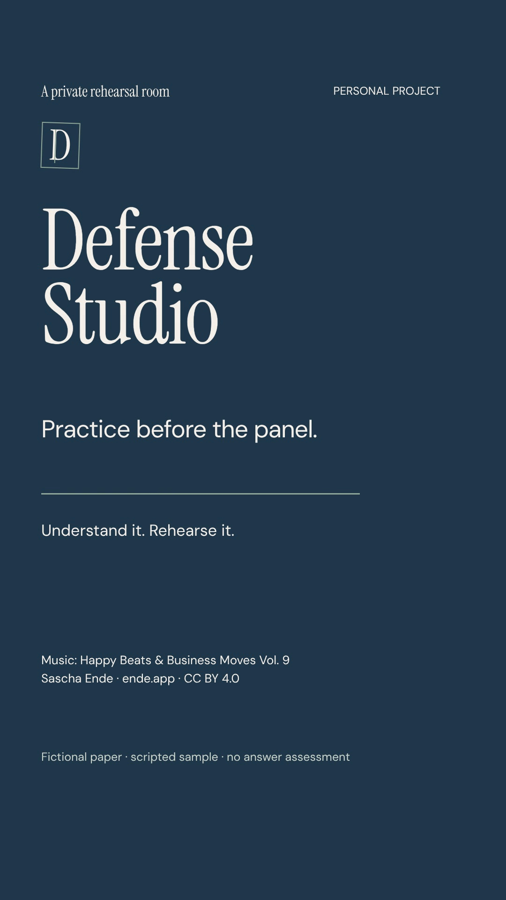

# Defense Studio

**Practice before the panel.** A local thesis-defense rehearsal workspace for reading a paper, grounding questions in its source, and practising typed answers. Version **0.2.0** · React + TypeScript · Node.js

The included sample is a fictional teaching paper with explicitly scripted rehearsal cues. Sample coaching does not assess your answers. Live Groq inference requires your own local configuration and explicit session consent; it has not been verified with a real API key or real thesis.

## Watch the ad

<a href="https://raw.githubusercontent.com/FrancisGiann/Defense-Studio/main/docs/media/Defense-Studio-practice-before-the-panel.mp4">
  
</a>

[Download the ad (MP4)](https://raw.githubusercontent.com/FrancisGiann/Defense-Studio/main/docs/media/Defense-Studio-practice-before-the-panel.mp4) · [View file on GitHub](docs/media/Defense-Studio-practice-before-the-panel.mp4) · [Caption and credits](docs/media/Defense-Studio-caption-and-credits.txt)

This is version 0.2.0 footage of the fictional sample with a staged typed answer. Music: [Happy Beats & Business Moves Vol. 9](https://ende.app/en/song/12874-happy-beats-business-moves-vol-9) by Sascha Ende, [CC BY 4.0](https://creativecommons.org/licenses/by/4.0/), excerpted, trimmed, faded, normalized and mixed for the ad. Full music, sound, typography, icon, and footage credits are linked above.

## Included

- Local PDF ingestion, retained source excerpts, and citations to physical PDF pages.
- Proposal/final modes, guided practice, and timed mock defense.
- Typed English or Tagalog answers, autosaved drafts, session history, and focus areas.
- An evidence notebook, source review, deletion, and local workspace export.
- A fictional sample that works without a key, account, or external AI request.

## Run locally

Requires **Node.js 24 or newer** and npm. Start from a fresh checkout:

```sh
git clone https://github.com/FrancisGiann/Defense-Studio.git
cd Defense-Studio
npm ci
npm run dev
```

Open **http://127.0.0.1:4317**. Stop with Ctrl+C. A new installation starts with an empty local paper library; choose **Explore a sample** to try the fictional teaching paper.

For production assets on the same local computer:

```sh
npm run build
NODE_ENV=production npm start
```

The app binds only to `127.0.0.1`. Personal mode uses a local browser trust boundary, not production multi-user authentication. Keep it local; public hosting would require a separate authentication and deployment design. See [security boundaries](docs/SECURITY.md).

## Optional Groq setup

The default configuration disables Groq and contains no API key. To configure your own key locally:

```sh
cp .env.example .env
# Edit .env locally: set GROQ_API_KEY and GROQ_ENABLED=true.
node --env-file=.env --watch --import tsx server/index.ts
```

Use the Node `--env-file` command above to load `.env`; `npm run dev` alone does not load that file. Never commit the file or paste a key into chat. Before any provider request, the app asks for consent for the selected paper's excerpts and session answers. The original PDF is not sent to Groq. Provider behavior, account costs, and data policies depend on your account and current Groq terms. The application's mock transport tests are not evidence of successful live inference.

## Storage and document limits

`.data/studio.sqlite` contains extracted paper text, sessions, answers, drafts, consent scope, and quota counters. It is local private storage and is excluded from Git. Raw uploaded PDF bytes are discarded after extraction. Workspace exports contain private source text and answers; store them privately. Keep original PDFs separately.

PDF limits are 10 MB, 120 physical pages, and 600,000 extracted characters. Scanned-only and password-protected PDFs are rejected; there is no OCR, DOCX, handwriting, audio-answer, or backup-import UI. Citation checks validate page/source identity and exact quotes, not the truth of model commentary. No grade or readiness score is produced.

## Development checks

```sh
npm run check
npm test
npm run build
```

`npm run test:ui` additionally requires Chrome at `/usr/bin/google-chrome` and a separate local QA server, normally port 4318, with isolated throwaway storage. The UI script resets its workspace; use synthetic QA data, never your personal paper library.

`src/` holds the React interface, `shared/` the types and fictional sample, `server/` the local service/provider boundaries, and `tests/` deterministic ingestion, evidence, repository, transport, and HTTP tests. The only published PDF is the verified fictional teaching sample. Private databases, papers, keys, development captures, build outputs, and the owner-private hosted preview are not included.

Instrument Serif and DM Sans are installed as font packages under their SIL Open Font Licenses; Lucide icons use ISC. The ad's full third-party attributions remain in its caption/credits file. Defense Studio is a provisional working title with no trademark claim.
